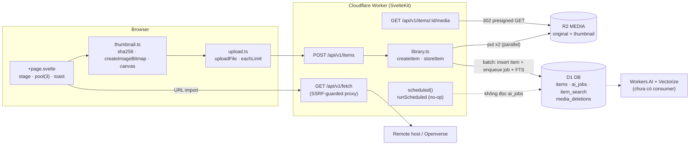
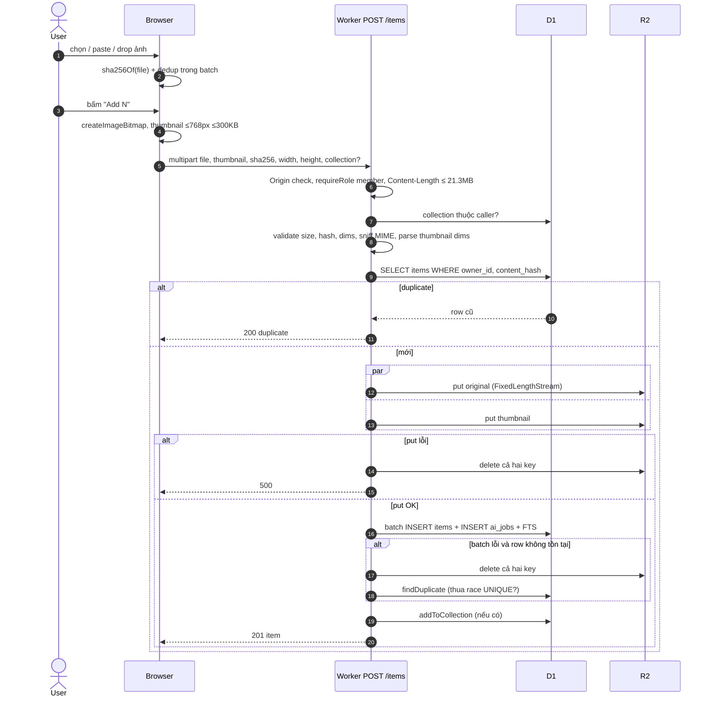
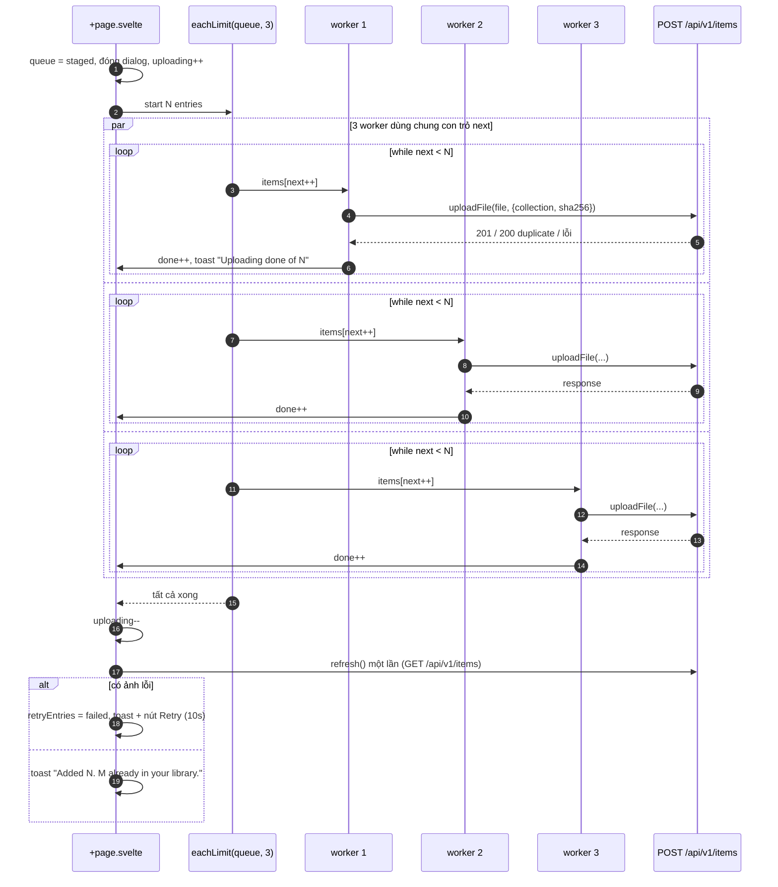

# Upload system design

Tài liệu mô tả cách một ảnh đi từ thiết bị người dùng vào Lmacaw: bytes nằm ở R2, metadata nằm ở D1, phân tích AI chạy qua job bất đồng bộ. Viết theo commit `6feda2d` trên nhánh `orch/upload-design`. Mọi khẳng định đều có trích dẫn `file:line`; **[unverified]** đánh dấu điều code trong repo không chứng minh được.

## 1. Requirements và constraints

### Functional requirements

- Người dùng thêm nhiều ảnh cùng lúc bằng chọn file, paste, drag-and-drop, hoặc dán URL (tối đa 50 URL) (`src/routes/+page.svelte:153-196`).
- Xem trước trước khi upload; không gì được upload cho đến khi bấm "Add N" (`+page.svelte:151`).
- Upload chạy ở background; dialog đóng ngay, toast báo tiến độ, ảnh lỗi có nút Retry (`+page.svelte:198-231`, `:497`).
- Dedup theo nội dung trong phạm vi một owner: cùng bytes → trả về item cũ (`library.ts:181-193`, `migrations/0001_init.sql:52`).
- Có thể thêm thẳng vào collection đang mở (`items/+server.ts:68-76,99-100`).
- Import từ Openverse giữ lại attribution/license (`items/+server.ts:78-92`).
- Mỗi item mới được xếp hàng phân tích AI (description, OCR, tags) (`library.ts:165-168,288`).

### Non-functional requirements

- **Integrity:** không có row D1 trỏ tới object R2 không tồn tại (thứ tự ghi R2 trước, D1 sau — `library.ts:272-290`).
- **Idempotency:** retry upload an toàn nhờ dedup theo hash (`library.ts:264-265`).
- **Security:** không tin MIME type hay thumbnail từ client; chống SSRF ở fetch proxy (§6).
- **Cost:** không decode/resize ảnh trên Worker; phục vụ media trực tiếp từ R2 qua presigned URL (§7).

### Constraints

| Constraint | Giá trị | Nguồn |
|---|---|---|
| Platform | Cloudflare Workers + D1 + R2 + Workers AI + Vectorize | `wrangler.jsonc` |
| Original tối đa | 20 MB | `library.ts:69,307` |
| Thumbnail tối đa | 300 KB, ≤ 768 px, WebP hoặc JPEG | `thumbnail.ts:1,3`, `library.ts:70,195-232,318-326` |
| Request body tối đa | 21 MB + 300 KB (`Content-Length` bắt buộc) | `items/+server.ts:10,43-46` |
| Định dạng original | JPEG, PNG, GIF, WebP (sniff magic bytes) | `media-validation.ts:1-9` |
| Kích thước ảnh khai báo | 1..20000 px mỗi chiều | `library.ts:309-311` |
| Auth modes | `public` (admin qua Cloudflare Access) và `password` (session cookie) | `hooks.server.ts:6-20`, `request.ts:51-75` |
| Workers không có DNS resolution | SSRF check chỉ dựa trên hostname literal | `fetch-image.ts:59-61` |
| Concurrency phía client | 3 upload song song | `+page.svelte:210` |

## 2. High-level architecture

| Thành phần | Vai trò | Vị trí |
|---|---|---|
| Browser (SvelteKit page) | Stage, hash, thumbnail, upload pool, toast | `src/routes/+page.svelte:150-231`, `src/lib/upload.ts`, `src/lib/thumbnail.ts` |
| `POST /api/v1/items` | Auth, size gate, parse form, validate, create | `src/routes/api/v1/items/+server.ts:36-110` |
| `GET /api/v1/fetch` | Image proxy phía server cho URL và Openverse | `src/routes/api/v1/fetch/+server.ts:8-32`, `src/lib/server/fetch-image.ts` |
| `createItem` / `storeItem` | Validate, dedup, ghi R2, insert D1 | `src/lib/server/library.ts:253-338` |
| R2 bucket `MEDIA` | Object original + thumbnail | `wrangler.jsonc` (`r2_buckets`), `src/lib/server/storage.ts` |
| D1 `DB` | `items`, `ai_jobs`, `item_search`, `media_deletions` | `migrations/0001_init.sql:35-123` |
| `GET /api/v1/items/:id/media` | Phục vụ qua presigned R2 URL hoặc stream qua Worker | `src/routes/api/v1/items/[id]/media/+server.ts:11-43` |
| `scheduled()` | Cron mỗi phút, hiện là no-op | `cloudflare/entry.ts:8-10`, `src/lib/server/cron.ts:3` |

## 3. Data model

### D1

**`items`** (`0001_init.sql:35-56`)

| Column | Ý nghĩa |
|---|---|
| `id` TEXT PK | UUID (`library.ts:267`) |
| `owner_id` FK → `users` | `ON DELETE CASCADE` |
| `content_hash` | SHA-256 hex do client gửi (`library.ts:308`) |
| `storage_key` UNIQUE | R2 key của original |
| `thumbnail_key` UNIQUE, nullable | R2 key của thumbnail |
| `content_type` | Từ magic-byte sniff, không từ client (`library.ts:315`) |
| `width`, `height` | Kích thước original do client khai báo |
| `description`, `tags` (JSON), `ocr_override` | Do người dùng sửa |
| `favorite`, `shared` | 0/1 (`CHECK`) |
| `source_metadata` (JSON) | Attribution Openverse |
| `revision` | Tăng khi text đổi (`library.ts:350,355`) |
| `created_at` | epoch ms (`db.ts:15-16`) |

Ràng buộc chính: `UNIQUE (owner_id, content_hash)` (`:52`) — vừa là dedup, vừa là chốt chặn race giữa hai upload cùng hash. Index: `(owner_id, created_at DESC, id DESC)`, `(shared, created_at DESC, id DESC)` (`:55-56`).

**`ai_jobs`** (`0001_init.sql:82-96`)

| Column | Ý nghĩa |
|---|---|
| `id` PK | UUID |
| `kind` | `image` (khi tạo item) hoặc `document` (khi sửa text) |
| `item_id` FK → `items` | `ON DELETE CASCADE` |
| `owner_id` | Không FK |
| `state` | `pending` → `leased` → `complete` / `failed` |
| `lease_token`, `lease_until` | Cho lease-based worker (chưa có worker — §5) |
| `attempts`, `revision` | Đếm retry; revision text đã phân tích |

Index: `(state, created_at)` để worker lấy job cũ nhất, `(item_id, kind)` để tìm job mới nhất của item (`:95-96`).

**`media_deletions`** (`0001_init.sql:104-107`): `storage_key` PK, `created_at`. Hàng đợi outbox cho R2 delete: key được ghi cùng batch xóa row, chỉ được xóa khỏi bảng khi R2 delete thành công (`library.ts:391-398,407-428`).

Bảng liên quan: `item_analysis` (kết quả AI, 1-1 với item, `:58-66`), `item_search` (FTS5, rebuild cùng batch, `:117-123`, `search.ts:16-40`), `collection_items` (`:76-80`).

### R2 key layout

- **Flat namespace**, không prefix, không thư mục: mỗi object là một key 64 ký tự hex ngẫu nhiên (256 bit) (`storage.ts:6-9`).
- Original và thumbnail là **hai key độc lập** (`library.ts:268-269`); mối liên kết chỉ nằm ở row D1.
- Key được validate `^[a-f0-9]{64}$` trước mọi thao tác R2 (`storage.ts:11-13`), chặn path injection.
- `Content-Type` lưu trong `httpMetadata` của object (`storage.ts:31`); original dùng type đã sniff, thumbnail dùng `image/webp` hoặc `image/jpeg`.
- Key không suy ra từ hash → hai owner cùng ảnh có hai bản riêng; xóa một bên không ảnh hưởng bên kia. Đánh đổi: tốn dung lượng gấp đôi cho ảnh trùng giữa các owner.
- Hệ quả vận hành: không có prefix (ví dụ `tmp/`) nên không thể dùng R2 lifecycle rule để dọn orphan (§4).

## 4. Luồng upload

### 4.1 Một ảnh

Các bước chi tiết:

1. **Stage.** Lọc file theo `image/*` (type khai báo) (`+page.svelte:154`). Mỗi file được hash SHA-256 một lần và dedup trong batch (`+page.svelte:159-164`). URL import đi qua proxy tuần tự, mỗi URL retry một lần, tối đa 50 (`+page.svelte:178-196`).
2. **Bấm "Add N".** Dialog đóng, queue chuyển cho `eachLimit(queue, 3, …)` (`+page.svelte:200-210`, `upload.ts:23-27`). Collection đích được chốt tại thời điểm bấm (`+page.svelte:146,201`).
3. **Chuẩn bị ở browser.** `prepareUpload` decode bằng `createImageBitmap` (áp EXIF orientation), tạo thumbnail ≤768 px, WebP 0.8 → fallback JPEG, giảm quality 0.7/0.6 để vừa 300 KB, không vừa thì throw (`thumbnail.ts:11-45,52-64`). Hash đã có được dùng lại, không tính lại (`thumbnail.ts:62`, `upload.ts:4`).
4. **Request.** Multipart gồm `file`, `thumbnail`, `sha256`, `width`, `height`, tùy chọn `collection`/`openverse` (`upload.ts:5-13`).
5. **Gate ở server.** Origin check → role `member` → `Content-Length` bắt buộc, là số, ≤ 21 MB + 300 KB (`items/+server.ts:10,39-46`). `request.formData()` (`:50`). Kiểm tra đủ field (`:55-66`). Collection phải tồn tại và thuộc caller — kiểm **trước** mọi thao tác ghi (`:68-76`). Metadata Openverse được server tự fetch, không tin client (`:78-92`).
6. **Validate** (`library.ts:305-326`): original ≤ 20 MB; hash khớp `^[a-f0-9]{64}$`; dims là số nguyên 1..20000; type original lấy từ magic bytes (`media-validation.ts:1-9`); thumbnail ≤ 300 KB, chỉ WebP/JPEG, parse kích thước đã encode và yêu cầu ≤ 768 (`library.ts:195-232,318-326`).
7. **Dedup.** Tìm theo `(owner_id, content_hash)`; trùng thì trả row cũ, bổ sung metadata Openverse nếu đang thiếu (`library.ts:181-193,264-265`).
8. **Ghi R2.** Hai key ngẫu nhiên (`library.ts:268-269`). Original và thumbnail `put` song song bằng `allSettled`, stream qua `FixedLengthStream` để R2 biết độ dài (`library.ts:331-336`, `storage.ts:15-32`).
9. **Ghi D1.** Một `db.batch`: insert `items`, enqueue `ai_jobs` (kind `image`, state `pending`), rebuild FTS (`library.ts:280-290,165-168`, `search.ts:16-40`).
10. **Collection.** Nếu có, gọi `addToCollection` — kể cả khi duplicate (`items/+server.ts:99-100`).
11. **Response.** `201` nếu mới, `200` nếu duplicate, kèm DTO (`items/+server.ts:101-105`).

### 4.2 Batch N ảnh (3 concurrent)

- `eachLimit` khởi tạo `min(3, N)` worker, mỗi worker lấy item tiếp theo qua con trỏ chung `next++`; JS single-thread nên không cần lock (`upload.ts:23-27`). Test chứng minh peak = 3 (`tests/upload-pool.test.ts:5-15`).
- Task không được throw: mọi lỗi được bắt và đẩy vào `failed` (`+page.svelte:211-217`).
- Đếm added/duplicate/failed (`+page.svelte:206,214-216`); **một** lần `refresh()` sau khi cả queue xong (`+page.svelte:220,147-149`).
- Ảnh lỗi giữ lại cho nút Retry trong toast, bấm thì mở lại Add dialog với chính các entry đó (`+page.svelte:223-231,497`).
- `beforeunload` hỏi xác nhận khi `uploading > 0` (`+page.svelte:397-398`).

## 5. Consistency giữa R2 và D1

Không có transaction xuyên hai store. Thứ tự là **R2 trước, D1 sau**, nên ở happy path không bao giờ có row trỏ tới object không tồn tại.

| Failure | Xử lý | Vị trí |
|---|---|---|
| Một trong hai R2 put lỗi | Chờ cả hai settle, rồi xóa cả hai key | `library.ts:270-277,330-336` |
| D1 batch throw, row không tồn tại | Xóa cả hai key; kiểm tra dedup lại (upload cùng hash song song thua race `UNIQUE` → trả bên thắng như duplicate) | `library.ts:292-301`, `0001_init.sql:52` |
| D1 batch throw, row đã tồn tại | Response mất sau khi commit → coi là thành công, giữ media | `library.ts:293-295` |
| D1 batch throw, re-check cũng lỗi | Không loại trừ được việc đã commit → giữ media, rethrow (500) | `library.ts:294,296` |
| Xóa item | Cùng batch: đưa key vào `media_deletions`, xóa FTS + row; sau đó xóa R2 và dequeue từng key | `library.ts:407-428,391-398` |

**Orphan (object R2 không có row) vẫn có thể xảy ra:**
- `discard()` dùng `allSettled` và bỏ qua lỗi delete (`library.ts:270-271`) — delete lỗi thì leak âm thầm, không ghi lại ở đâu.
- Worker bị evict/timeout giữa R2 put và D1 commit để lại object không có row và không có bản ghi **[unverified: phụ thuộc runtime limits]**.
- Nhánh "không loại trừ được commit" cố ý giữ media (`library.ts:296`); nếu thực ra commit đã fail thì cả hai object leak.

**Retry / thiếu sweeper:** `cleanupDeletedMedia` dọn `media_deletions` (`library.ts:400-404`) nhưng **không có nơi nào gọi** — cron handler là no-op (`cron.ts:3`, `entry.ts:8-10`; grep repo không thấy caller khác). Vì vậy lỗi R2 delete lúc xóa item nằm trong hàng đợi mãi. Cũng không có sweeper cho orphan lúc upload.

**Idempotency:** dedup server theo `(owner_id, content_hash)` làm retry phía client an toàn — upload thực ra đã thành công thì retry nhận `200 duplicate` (`library.ts:264-265`, `+page.svelte:214`). Client không tự retry upload; chỉ có Retry thủ công (`+page.svelte:226-231`).

## 6. Async AI pipeline

- **Enqueue:** atomic cùng insert item (`library.ts:288`). Sửa text thì enqueue job `document` và xóa các job pending/failed cũ (`library.ts:357-365`).
- **Schema** hỗ trợ lease (§3): `state`, `lease_token`, `lease_until`, `attempts` (`0001_init.sql:82-96`). Bảng `ai_usage` để theo dõi neuron budget (`:98-102`).
- **Manual retry:** `POST /items/:id/retry-ai` đưa image job lỗi gần nhất về `pending` (`retry-ai/+server.ts:7-17`, `library.ts:171-179`).
- **Consumer: chưa implement.** Cron chạy mỗi phút (`wrangler.jsonc` `triggers.crons`) nhưng `runScheduled` rỗng (`cron.ts:3`). Không có code nào đọc `ai_jobs` để lease, gọi `env.AI`, ghi `item_analysis`, hay upsert Vectorize (grep repo: `env.AI`/`lease_token` không có consumer). Job tích tụ ở `pending`. `updateItem` ghi chú Vectorize sync để dành cho "Milestone C" (`library.ts:369`).

## 7. Security và limits

| Vấn đề | Kiểm soát | Vị trí |
|---|---|---|
| AuthN/Z | `requireRole('member')`; public mode = admin có Access JWT trên `ADMIN_HOST`, password mode = session cookie | `items/+server.ts:40`, `request.ts:66-75`, `hooks.server.ts:6-20` |
| CSRF | `Origin` phải khớp chính site hoặc danh sách `ORIGIN` (thiếu Origin thì cho qua) | `request.ts:26-32`, `items/+server.ts:39` |
| Body size | `Content-Length` bắt buộc (411), ≤ 21.3 MB (413) trước khi parse | `items/+server.ts:10,43-46` |
| Size từng phần | Original ≤ 20 MB, thumbnail ≤ 300 KB | `library.ts:69-70,307,318` |
| Khai man độ dài | `FixedLengthStream` làm put fail nếu số byte ≠ khai báo | `storage.ts:23-30` |
| MIME | Bỏ qua type client; magic-byte sniff quyết định `content_type`; không nhận ra → 400 | `library.ts:315-316`, `media-validation.ts:1-9` |
| Thumbnail độc hại | Allowlist WebP/JPEG + parse dims ≤ 768; JPEG scan bị chặn bởi 300 KB | `library.ts:318-326`, `media-validation.ts:11-14` |
| Collection IDOR | Kiểm ownership trước khi ghi → 404 | `items/+server.ts:73-76` |
| Key safety | Key 64-hex ngẫu nhiên, validate ở mọi thao tác R2 | `storage.ts:6-13` |
| Serving | Presigned GET 10 phút, ép `content-type`; fallback stream đặt `nosniff` | `media-url.ts:16-28`, `media/+server.ts:28-42` |
| SSRF (fetch proxy) | Chỉ http/https, không userinfo, blocklist hostname literal (loopback, RFC1918, CGNAT, link-local, multicast, ULA, mapped v6) kiểm lại ở mỗi redirect thủ công (tối đa 4), timeout 15 s, cap 20 MB khi stream, sniff magic bytes trước khi trả | `fetch-image.ts:10-63,117-140,65-114` |

**Lỗ hổng / ghi chú:**
- `sha256` do client gửi và không được server kiểm lại (`library.ts:308` chỉ kiểm format). Ảnh hưởng giới hạn trong thư viện của chính caller: client nói dối có thể khiến ảnh khác bị coi là duplicate của item của chính họ. Impact thấp; đóng được bằng một lần hash phía server.
- `width`/`height` do client khai báo, chỉ kiểm range (`library.ts:309-311`).
- Không có rate limit cho upload hay `/fetch`; `allowAttempt` có sẵn nhưng không dùng ở đây (`request.ts:38-49`).
- Blocklist SSRF chỉ dựa trên hostname literal; tên miền resolve ra IP private phụ thuộc vào việc egress của Cloudflare không vào được mạng private (`fetch-image.ts:59-61`) **[unverified platform guarantee]**.
- `/fetch` yêu cầu `member` (`fetch/+server.ts:11`), nên không phải open proxy.
- Decompression bomb: server không bao giờ decode pixel, rủi ro chỉ nằm ở browser của chính người upload.

## 8. Performance và cost

- **Thumbnail phía client** (`thumbnail.ts:11-45`): Worker không tốn CPU decode/resize; Workers không có codec ảnh native nếu không dùng Images binding **[unverified cost comparison]**. Đánh đổi: server phải validate thumbnail không tin cậy (§7).
- **Hash một lần** lúc stage, dùng lại lúc upload (`+page.svelte:160`, `upload.ts:4`, `thumbnail.ts:62`).
- **Concurrency 3** (`+page.svelte:210`): giới hạn bộ nhớ browser (mỗi file đang chạy giữ một bitmap đã decode + canvas) và nằm dưới giới hạn 6 connection của HTTP/1.1, chừa chỗ cho request UI. Chứng minh bởi `tests/upload-pool.test.ts:5-15`.
- **R2 put song song** (`library.ts:331-334`): latency ≈ max(original, thumb) thay vì tổng.
- **Một lần refresh** sau cả queue thay vì mỗi file (`+page.svelte:220`): một list query (≤ 201 row, `library.ts:68,157-160`) thay vì N.
- **Một D1 batch** mỗi lần tạo (`library.ts:280-290`): một round trip, atomic.
- **Presigned media URL** (`media/+server.ts:28-31`): bytes do R2 phục vụ, không proxy qua Worker; 302 được cache 5 phút.

## 9. Bottleneck và scale 10× / 100×

Hiện trạng: mọi byte original đi qua Worker; body được parse toàn bộ bằng `request.formData()` (`items/+server.ts:50`) **[unverified: workerd buffer hay spool multipart; giả định buffer → tới ~21 MB trong isolate memory mỗi request]**.

| Bottleneck | 10× | 100× |
|---|---|---|
| Bytes đi qua Worker (memory, request-size cap, CPU parse multipart) | Ổn; thêm rate limit upload bằng `allowAttempt` | **Presigned PUT thẳng vào R2** (dùng lại `aws4fetch`, `media-url.ts`): `POST /uploads` → `{key, thumbKey, url, thumbUrl}`; client PUT; `POST /items/commit` HEAD cả hai object, sniff bằng `headBytes` (`storage.ts:34-39`, đã có, chưa dùng), rồi insert row |
| AI job không bao giờ chạy (§6) | Implement cron consumer: lease N job với `lease_until`, gọi AI, ghi `item_analysis`, đánh dấu complete | Chuyển sang **Cloudflare Queues** (enqueue sau commit; row D1 vẫn là source of truth) để tách khỏi nhịp cron 1 phút và có retry/DLQ |
| Orphan / media chưa xóa | Gọi `cleanupDeletedMedia` từ cron (một dòng trong `cron.ts`) | Bảng pending-upload (`key, created_at`) ghi trước put, xóa khi commit; sweeper xóa key cũ. Hoặc R2 lifecycle trên prefix `tmp/` + copy-on-commit (cần đổi key layout §3) |
| File lớn / mạng mobile chập chờn | Kiểm size phía client (≤ 20 MB) để fail trước khi upload | **Resumable upload**: R2 multipart (hoặc tus) với retry từng part |
| D1 single-writer | Ổn | Batch nhỏ; theo dõi chi phí rebuild FTS `item_search` và tăng trưởng index `ai_jobs`; archive job đã complete |
| Hash/thumbnail trên main thread | Ổn | Chuyển `prepareUpload` sang Web Worker (đường OffscreenCanvas đã có, `thumbnail.ts:13-15`) |

## 10. Trade-offs và open issues

1. **Thiếu AI consumer** — job được enqueue nhưng không bao giờ chạy (`cron.ts:3`). Gap ảnh hưởng lớn nhất.
2. **`cleanupDeletedMedia` không được gọi** — lỗi R2 delete khi xóa item không bao giờ được retry (`library.ts:400`).
3. **Orphan leak âm thầm** khi `discard()` lỗi và khi Worker chết giữa chừng (`library.ts:270-277`).
4. **Hash client không được kiểm** — dedup tin client (`library.ts:308`).
5. **Không có rate limit upload/fetch** (`items/+server.ts`, `fetch/+server.ts`).
6. **Đóng tab mất queue** — chỉ có prompt `beforeunload` (`+page.svelte:397-398`); không lưu gì lại.
7. **Không kiểm size/type phía client** ngoài `image/*`: HEIC hoặc file > 20 MB chỉ fail sau khi upload/decode (`+page.svelte:154`, `library.ts:307,316`).
8. **Collection chốt lúc bấm** — đổi view giữa chừng vẫn upload vào collection ban đầu (cố ý; `+page.svelte:201`).
9. **Collection bị xóa giữa lúc upload** — ownership kiểm trước khi ghi, nhưng `addToCollection` chạy sau và throw khi collection không còn (`items/+server.ts:74,100`, `collections.ts:52-67`). Item đã được lưu nhưng request trả 500; client đếm là lỗi, và Retry gặp lại cùng lỗi trên nhánh duplicate.
10. **Thumbnail GIF động** chỉ là một frame từ `createImageBitmap` **[unverified browser behavior]**; original vẫn giữ animation.
11. **Key R2 không content-addressed** — ảnh trùng giữa các owner lưu nhiều bản (§3); đổi lại xóa độc lập, không cần reference counting.
